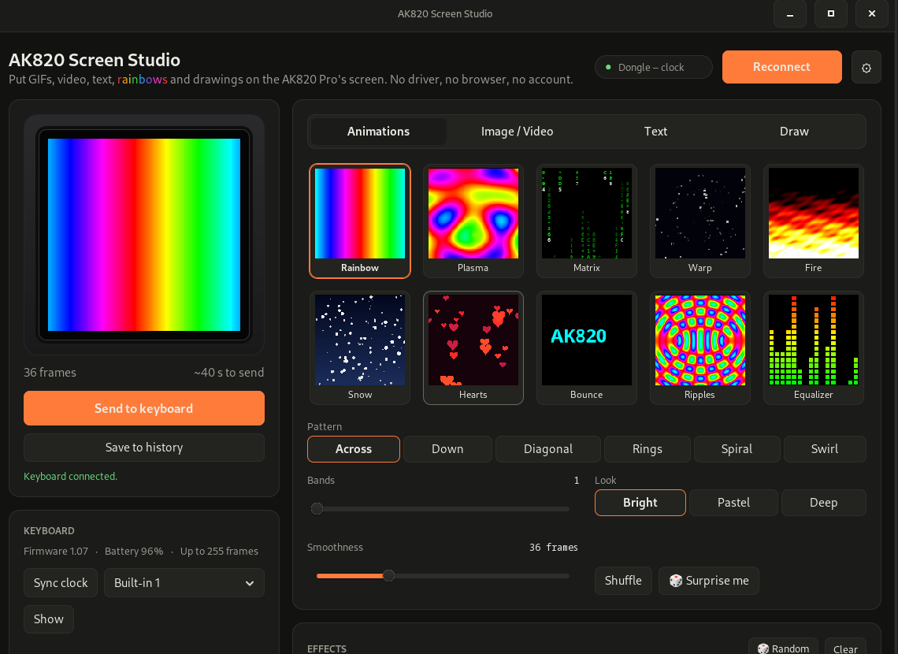
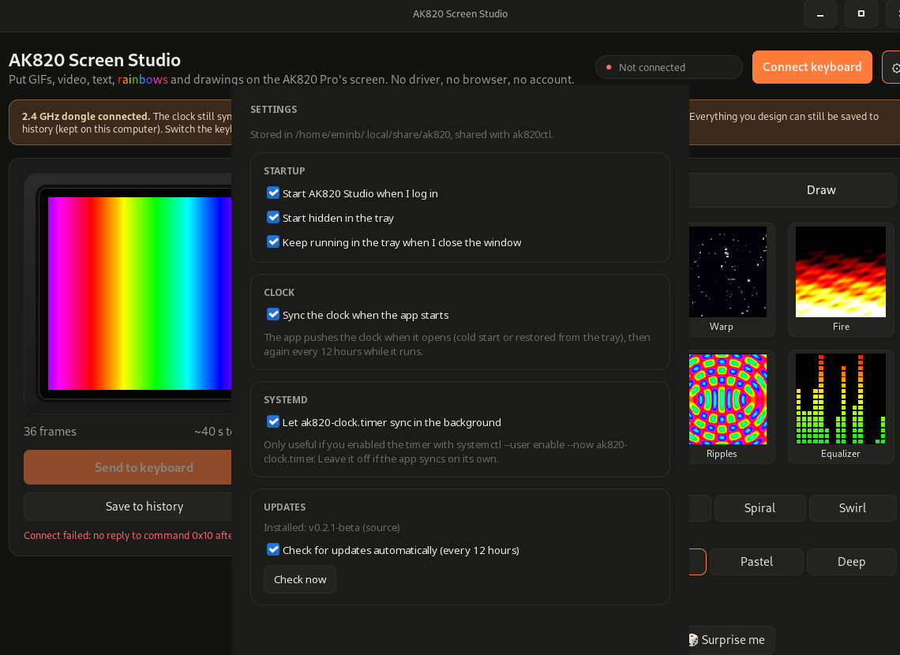

# AK820 Screen Studio

[](https://github.com/WhatTFF/linux-ajazz-ak820-pro-gtk/actions/workflows/ci.yml)
[](https://github.com/WhatTFF/linux-ajazz-ak820-pro-gtk/releases)
[](LICENSE)
[](#download)

Native Linux app for the **AJAZZ / Epomaker AK820 Pro** keyboard screen — put GIFs, images, video, text, drawings and procedural animations on the 0.85" 128×128 screen, then forget about it.

A Rust/GTK3 rewrite of [fromagge/ak820-screen](https://github.com/fromagge/ak820-screen) with automatic clock sync. Unofficial — not affiliated with AJAZZ or Epomaker.

> The original Rust/Tauri version lives at
> [WhatTFF/linux-ajazz-ak820-pro-app](https://github.com/WhatTFF/linux-ajazz-ak820-pro-app).
> This GTK version is the actively developed native Linux build.

---

## Screenshots

| Main window | Settings |
| --- | --- |
|  |  |

---

## Download

Prebuilt x86_64 packages are attached to every [release](https://github.com/WhatTFF/linux-ajazz-ak820-pro-gtk/releases):

[](https://github.com/WhatTFF/linux-ajazz-ak820-pro-gtk/releases)
[](https://github.com/WhatTFF/linux-ajazz-ak820-pro-gtk/releases)
[](https://github.com/WhatTFF/linux-ajazz-ak820-pro-gtk/releases)

| Format | Distros | Install |
| --- | --- | --- |
| `.rpm` | Fedora, RHEL, openSUSE | `sudo dnf install ./ak820-gtk-*.rpm` |
| `.deb` | Debian, Ubuntu, Mint, Pop!_OS | `sudo apt install ./ak820-gtk_*.deb` |
| `.AppImage` | any glibc distro, no root | `chmod +x ak820-gtk_*.AppImage && ./ak820-gtk_*.AppImage` |

Every release carries the three packages plus a `SHA256SUMS` file. The app checks for updates itself — you don't have to come back here.

All three need **GTK 3** at runtime (ships with Fedora Workstation and Ubuntu 22.04+). Video files additionally need `ffmpeg` on `PATH`. A tray requires a StatusNotifier host; on plain GNOME that means the AppIndicator extension.

---

## What it does

**Put pictures on your keyboard screen.** Drag and drop images, GIFs or video. Draw, add text, apply effects, adjust colors. Send it to the AK820 Pro's 0.85" 128×128 screen over USB-C.

**Clock stays in sync.** The app pushes your computer's clock on start, on plug-in, every 12 hours while it runs, and whenever you press **Sync clock**. The keyboard's clock never drifts.

**Works over the 2.4 GHz dongle.** Clock sync works over the dongle; pictures need the USB-C cable (the dongle has no screen interface). Designs can always be saved to history and sent later when the keyboard is on the cable.

> **2.4 GHz dongle warning.** The clock still syncs over the dongle, but the screen itself only answers on the USB cable, so sending pictures is paused. Everything you design can still be saved to history (kept on this computer). Switch the keyboard to **wired** and plug in the **USB-C cable** to send.

**Tray-friendly.** Keep it running in the tray, start hidden, sync at login — set it and forget it.

---

## Features

| Feature | Details |
| --- | --- |
| 🖼️ **Images, GIFs, video** | Drag and drop, clipboard paste, or pick a file; frames are extracted automatically |
| 🎨 **Draw, text, effects** | Built-in canvas, text generator, captions, and procedural animations |
| ⏰ **Clock autosync** | Sync on start, on plug-in, every 12 h, or on demand from the device panel or tray |
| 💾 **History** | Every design is saved on disk; restore, delete one entry, or clear everything |
| 🗄️ **Tray icon** | StatusNotifierItem / AppIndicator with Open, Sync clock now and Quit |
| 📦 **In-app updates** | Checks GitHub releases; AppImage replaces itself, RPM/DEB offers a polkit install prompt |
| 🔎 **GIPHY search** | Paste your own API key in Image / Video; key stays on this computer |
| ⌨️ **ak820ctl CLI** | `info`, `time`, `upload`, `builtin`, `history`, `raw` — everything scriptable |
| 🔒 **Offline-friendly** | No network needed except for update checks and optional GIPHY search |

---

## System requirements

- **Linux x86_64** (Fedora Workstation, Ubuntu 22.04+, Debian, etc.)
- **GTK 3** (ships with Fedora Workstation and Ubuntu 22.04+)
- **udev rule** for hidraw access (installed by the RPM and DEB; one-time manual step for AppImage)
- **ffmpeg** on `PATH` for MP4/WebM/MKV video import (optional)
- **StatusNotifier host** for the tray icon (KDE, GNOME + AppIndicator extension, etc.)

---

## Quick start

**From a package:**

```bash
# Fedora / RHEL
sudo dnf install ./ak820-gtk-*.rpm

# Debian / Ubuntu
sudo apt install ./ak820-gtk_*.deb

# AppImage
chmod +x ak820-gtk_*.AppImage
./ak820-gtk_*.AppImage
```

If you use the AppImage, install the udev rule once:

```bash
sudo install -Dm644 udev/70-ak820.rules /usr/lib/udev/rules.d/70-ak820.rules
sudo udevadm control --reload && sudo udevadm trigger
```

Then flip the keyboard's mode switch to **wired**, plug in the **USB-C cable**, open AK820 Screen Studio, and send your first design. Unplug and replug the keyboard after installing the udev rule.

**From source (Fedora):**

```bash
sudo dnf install gtk3-devel gdk3-devel glib2-devel cargo rust gcc gcc-c++ pkgconf-pkg-config
# optional, for video files:
sudo dnf install ffmpeg

cargo build --release -p ak820-gtk -p ak820-cli
sudo install -Dm755 target/release/ak820-gtk /usr/local/bin/
sudo install -Dm755 target/release/ak820ctl /usr/local/bin/
sudo install -Dm644 udev/70-ak820.rules /usr/lib/udev/rules.d/70-ak820.rules
sudo udevadm control --reload && sudo udevadm trigger
```

Unplug and replug the keyboard after installing the rule. Then:

```bash
ak820ctl info                 # interfaces, firmware, frame limit
ak820ctl upload cat.gif       # PNG / JPEG / WebP / GIF
ak820ctl time                 # push the clock once
./target/release/ak820-gtk    # the app
```

---

## Clock autosync with systemd

The app syncs while it runs. If you want the clock to stay correct while the app is closed, install the user units:

```bash
mkdir -p ~/.config/systemd/user
cp systemd/ak820-*.service systemd/ak820-clock.timer ~/.config/systemd/user/
systemctl --user daemon-reload
systemctl --user enable --now ak820-clock.timer
systemctl --user enable ak820-resume.service
```

Enable the same option in **Settings → Systemd** so the timer and the app do not fight over the keyboard.

---

## Credits

Upstream protocol research, web UI, generators and effects: **fromagge/ak820-screen** (MIT).
The shared Rust crates and the original Tauri app: **WhatTFF/linux-ajazz-ak820-pro-app** (MIT).
This project is a GTK3 rewrite; see [NOTICE](NOTICE) and [docs/UPSTREAM.md](docs/UPSTREAM.md).

AK820 Screen Studio is licensed under the **GNU General Public License v3.0 only**. The MIT-licensed upstream parts remain under MIT; see [LICENSE-MIT](LICENSE-MIT).

Community: [Contributing](CONTRIBUTING.md) · [Code of Conduct](CODE_OF_CONDUCT.md) · [Security](SECURITY.md)

---

**Source, issues and releases:** [https://github.com/WhatTFF/linux-ajazz-ak820-pro-gtk](https://github.com/WhatTFF/linux-ajazz-ak820-pro-gtk) · [releases](https://github.com/WhatTFF/linux-ajazz-ak820-pro-gtk/releases) · [issues](https://github.com/WhatTFF/linux-ajazz-ak820-pro-gtk/issues)
